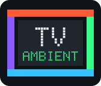
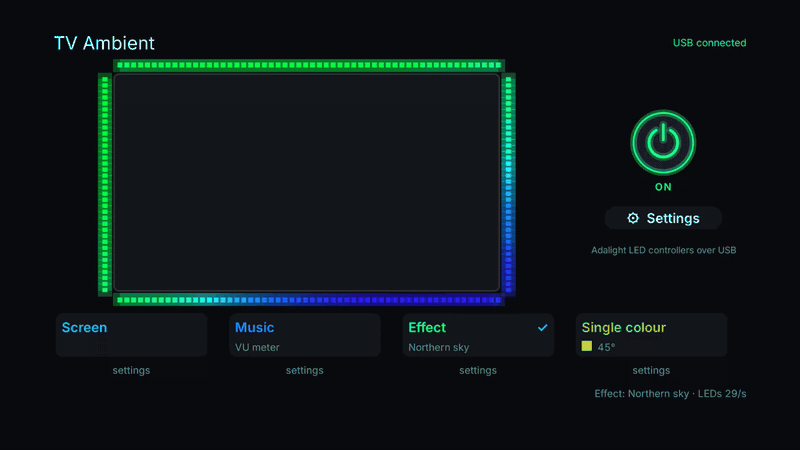
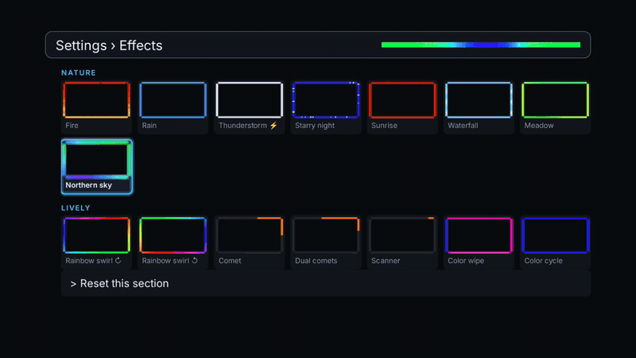
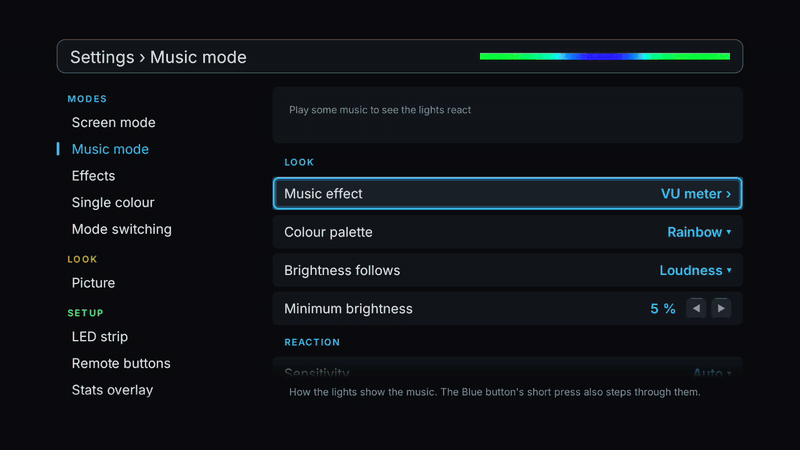
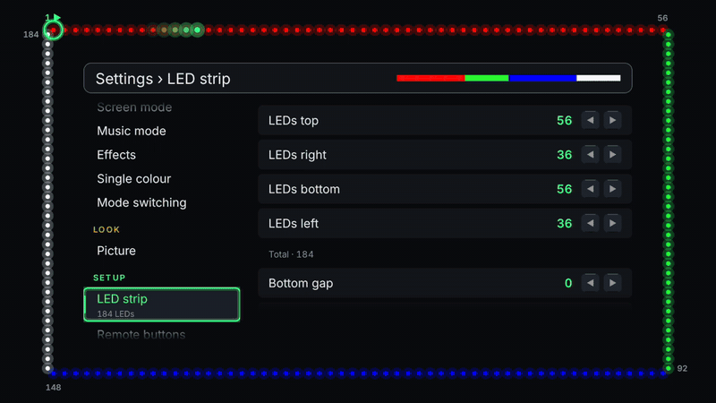
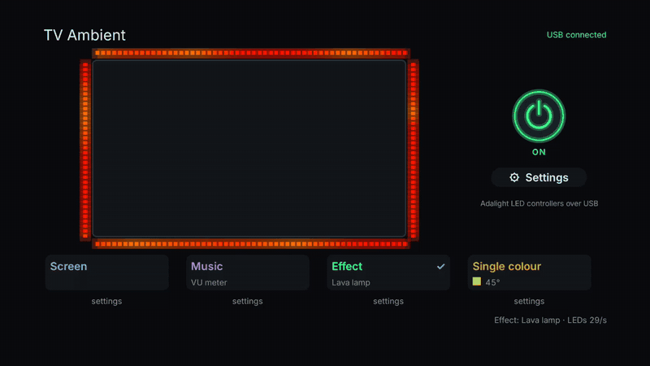
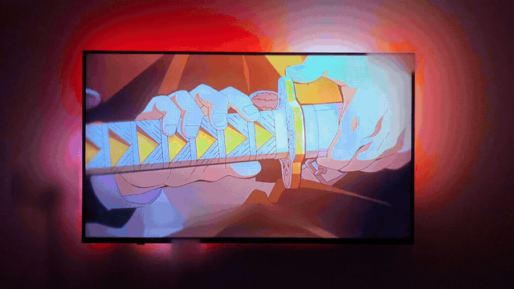

<p align="center">
  
</p>

<h1 align="center">TV Ambient</h1>

<p align="center">
  <b>Ambient lighting for Android TV.</b> Your LED strip follows the picture, the music, or a calm effect.<br>
  A small Rust core and a Kotlin app, running on the TV itself — no PC, no camera, no cloud.
</p>

<p align="center">
  <a href="https://github.com/noman13/tv-ambient/releases/latest"></a>
  
  
  
  
  <a href="LICENSE"></a>
</p>

<p align="center">
  
</p>

TV Ambient drives an **Adalight** LED controller (an ESP8266 or Arduino with WS2812B LEDs) plugged into the TV's USB
port. In **Screen** mode the LEDs round the back of the TV take the colours at the edges of whatever is playing, in
any app. **Music** mode makes them react to the sound, **Effect** mode runs one of 52 built-in effects, and
**Single colour** keeps one steady colour.

**[Download the latest APK from GitHub Releases](https://github.com/noman13/tv-ambient/releases)** · Tested on a
Haier K66 (Android TV 14) · Version 1.0.0

## Features

* **Screen mode** that follows the picture in any app, including other players and the TV's own apps. It finds black
  bars (letterbox and pillarbox) and samples the picture's real edges, and an **Adaptive** capture rate backs off
  when the TV gets busy.
* **Music mode** with 13 music effects (VU meter, Spectrum, Bass glow, Spectrum bars and more). It listens to the
  TV's **sound output**, never a microphone.
* **52 effects** in six groups, from Northern sky and Lava lamp to Fire, Plasma and Fireworks, plus setup patterns
  for checking your strip. Flashing effects are marked ⚡, capped at 3 flashes a second and left out of the rotation
  by default.
* **Single colour** with a colour picker and brightness.
* **Remote shortcuts** on the coloured buttons, from any app: Red turns the lights on or off, Green opens or closes
  Settings, Yellow shows a stats overlay, Blue changes mode or effect. All four are configurable, and they stay out
  of the way in Live TV.
* **LED strip setup** that draws your LEDs round the edge of the screen, so you can match the count, corners and
  direction to the wall.
* **Stats overlay** ("stats for nerds"): capture and LED rates, video fps, CPU, memory, USB and network use, live
  over the video.
* **Built for a 10-foot remote:** every setting is at most two steps from Home, changes show on the LEDs at once, and
  there's no Save button.
* **Small and private:** a ~326 KB APK, no ads, no analytics, no network use beyond the TV's own ADB port on
  `127.0.0.1`.

## Screenshots

| Effects | Music effects |
|---|---|
|  |  |
| **LED strip setup** | **Lava lamp on Home** |
|  |  |

The recordings come straight from the TV's screen; on the wall, the strip shows the same colours as the preview.

## Live demo

TV Ambient in Screen mode on the reference TV: the strip behind the TV follows the picture as it plays.

<p align="center">
  
</p>

## What you need

* An **Android TV** running Android 8 to 16 (tuned on Android TV 14) with a USB port.
* An **Adalight LED controller** over USB serial, for example an ESP8266 or Arduino with WS2812B LEDs, running an
  Adalight sketch. Boards with CH340/CH341, CP210x or FTDI FT232 USB chips, and Arduino boards, are recognised when
  plugged in. Other protocols (WLED, Hyperion, DMX) aren't supported yet.
* A strip round the back of the TV. Any count per side works; you set it up on the TV.

## Install and set up

1. Download `tv-ambient-1.0.0.apk` from [Releases](https://github.com/noman13/tv-ambient/releases) and install it
   (for example with a file manager app, or `adb install tv-ambient-1.0.0.apk`).
2. Plug the LED controller into the TV and open **TV Ambient**. First run takes three short steps:
   1. **Controller:** allow TV Ambient to use the USB device when Android asks.
   2. **USB debugging:** the screen tells you what to do on your TV (turn on Developer options, then USB
      debugging) and comes back by itself once the switch is on. When the TV asks *"Allow USB debugging?"*, tick
      **Always allow**. This lets Screen mode use the TV's own screenshot service, which is much smoother than
      screen recording. You can skip it and use screen recording instead.
   3. **Strip:** count the LEDs on each side and where LED 1 is; the setup page draws them round the screen.
3. Press **Red** on the remote to turn the lights on or off, **Blue** to change mode, and **Green** for Settings.

Remote shortcuts turn on by themselves once USB debugging works. You can turn them off in
Settings › Remote buttons.

## How it works

```
 Shell user (the TV's own adbd on 127.0.0.1)              TV Ambient app
 ┌──────────────────────────────────────┐            ┌───────────────────────────────────────────┐
 │ Capture helper (Kotlin, app_process) │  LED       │ Foreground service (Kotlin)               │
 │   display capture → HardwareBuffer   │  colours   │   Rust: colour tables, smoothing,         │
 │   Rust: black bars + edge colours    │ ─────────► │         effects, music, Adalight frames   │
 │   (zero-copy, ~5-10 ms a frame)      │  ~0.5 KB   │   USB serial → LED controller             │
 └──────────────────────────────────────┘            │ Accessibility service: colour buttons     │
                                                     │ UI: plain Android Views                   │
                                                     └───────────────────────────────────────────┘
```

* **The capture helper** runs as the shell user, started over the TV's own ADB with the app's own key. That gives
  it the system's screenshot service, which doesn't disturb video playback the way screen recording does. It
  analyses each frame where it was captured and sends only the LED colours to the app, about 0.5 KB instead of a
  27 KB frame.
* **Without USB debugging** the app falls back to Android's screen recording (`MediaProjection`).
* **Music** comes from Android's `Visualizer` on the output mix (or, on Android 13+, the helper's playback capture),
  analysed by the Rust core: FFT, beat detection, and the music effects.

### A Rust core, where the work is

Everything that runs per frame is Rust: edge analysis, black-bar detection, colour correction, smoothing, the 52
effects, the audio analysis and the Adalight output. One library, `libtvambient.so`, is loaded both by the capture
helper and by the app.

* **`no_std`, no crates.** The core uses only `core` and `alloc`; the JNI layer is `no_std` too, with a hand-written
  binding to the five JNI calls it needs. The whole library is **under 60 KB per ABI**.
* **No allocation per frame** and no JNI calls inside loops: fixed buffers, one 256-entry lookup table per channel
  with gamma, white balance and brightness combined.
* **Never panics across FFI:** panics abort, and every export checks its inputs and returns an error code.
* **Zero-copy capture:** the helper locks the `HardwareBuffer` from Rust and reads the edges in place.
* **Tested on the host:** golden tests feed real TV captures (Big Buck Bunny, Sintel and others) through the
  pipeline and match an independent reference implementation bit for bit; every effect is rendered for 10 s and
  checked for range, flash rate and a stable hash.

The Kotlin side stays small on purpose: platform Views (no AppCompat, Material or Compose), no coroutines or
reflection libraries, R8 full mode, and its own minimal ADB client. That keeps the APK around **326 KB**.

## Performance

Measured on the reference TV (Haier K66, 4 cores, ~1.4 GB RAM), 60 s per run. CPU per process is a percentage of
one core. Full tables, caveats and the method: [`.agents/PERFORMANCE.md`](.agents/PERFORMANCE.md).

| Playing | TV Ambient CPU (app + helper) | Capture | Playback with the lights on |
|---|---|---|---|
| 1080p60, SmartTube | 4.7 % + 7.8 % | 15/s, 8.1 ms each | 0 decoder drops, 58.9 fps |
| 1440p60, SmartTube | 4.5 % + 8.5 % | 15/s, 9.6 ms each | 7 decoder drops a minute |
| 4K30, SmartTube | 4.4 % + 7.8 % | 14/s, 7.6 ms each | 0 decoder drops, 30.0 fps |
| Music mode, VU meter | 3.3 % (no helper) | — | — |
| Effect (Northern sky) | 4.3 % | — | — |

Known limits in 1.0.0: 4K60 already drops frames on this TV with the lights off, and more with them on; Nuvio's
1080p24 playback stutters in Screen mode because capturing its video is unusually slow (~74 ms a frame). Both are on
the [roadmap](.agents/TECHNICAL.md#17-roadmap-not-done-yet).

## Build from source

Docker is the only requirement; the image has the Android SDK, NDK and Rust toolchain.

```bash
scripts/build.sh          # release APK in dist/ (debug-signed unless KEYSTORE_DIR points at your keys)
scripts/build.sh test     # Rust host tests: golden outputs, effects, music
scripts/build.sh debug    # debug APK
scripts/build.sh shell    # a shell in the build image, repo at /src
```

On Windows: `.\scripts\build.ps1 [release|debug|test|shell]`.

## Documentation

| Read | For |
|---|---|
| [`.agents/PROJECT.md`](.agents/PROJECT.md) | Repo map, build and install, reference hardware, rules for changes, ideas tried and rejected |
| [`.agents/TECHNICAL.md`](.agents/TECHNICAL.md) | Architecture: capture, analysis, the Rust core and JNI, modes, music, effects, roadmap |
| [`.agents/DESIGN.md`](.agents/DESIGN.md) | The interface: navigation, every screen, visual tokens, remote buttons |
| [`.agents/PERFORMANCE.md`](.agents/PERFORMANCE.md) | Measured resource use and how to measure it |
| [`AGENTS.md`](AGENTS.md) | Quick start for AI coding agents (and people) |
| [`.agents/skills/tv-ambient-android/`](.agents/skills/tv-ambient-android/SKILL.md) | An agent skill for Android TV work on this project, built on upstream Android guides |
| [`CONTRIBUTING.md`](CONTRIBUTING.md) | How to contribute |

## Third-party software and media

| What | Used for | Licence |
|---|---|---|
| [usb-serial-for-android](https://github.com/mik3y/usb-serial-for-android) | USB serial drivers | MIT |
| [Inter](https://rsms.me/inter/) | The app font (subset) | SIL Open Font License 1.1 ([`LICENSES/`](LICENSES/)) |
| *Big Buck Bunny*, *Sintel* (Blender Foundation) | Golden test frames and benchmark clips | CC BY 3.0 |
| *Night of the Living Dead* (1968) | Golden test frames | Public domain (US) |
| Android guides in the agent skill | Agent instructions | MIT / Apache-2.0 ([`SOURCES.md`](.agents/skills/tv-ambient-android/SOURCES.md)) |

TV Ambient doesn't copy screens, text, icons or colours from other ambient-light apps.

## Contributing

Bug reports, measurements from other TVs and pull requests are welcome. Please read
[`CONTRIBUTING.md`](CONTRIBUTING.md) first: it covers the build, the tests, and the few rules that keep the app small
and safe.

## Licence

[MIT](LICENSE). Third-party licences are listed above and in [`LICENSES/`](LICENSES/).

## Releases

Every version, with its signed APK, SHA-256 checksum and release notes, is on the
[Releases page](https://github.com/noman13/tv-ambient/releases). The newest one is always at
[releases/latest](https://github.com/noman13/tv-ambient/releases/latest).
